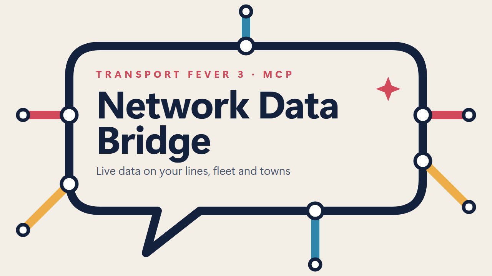

<p align="center"></p>

# Network Data Bridge (MCP) for Transport Fever 3

Ask questions about your running game from any AI chat app that supports the Model Context Protocol (MCP):
*"Which lines lose money?"*, *"Which trains are past their lifespan, and what should replace them?"*, *"Which big
towns have no rail service?"* The app answers with live numbers from your game. The mod only shares data: it adds
no AI-generated content and changes nothing in the game.

It has two parts:

- **The game mod** "Network Data Bridge (MCP)", [on mod.io](https://mod.io/g/transportfever3/m/ai-assistant-bridge-mcp). It answers requests with live data from your game and
  does nothing between requests. It is **read-only**: it never changes your game and makes no network connections.
- **A small MCP server**, `server/tf3_mcp_server.py`. It's one Python file that uses only the standard library,
  downloaded from this repository's releases. (mod.io doesn't allow `.py` files in mods.) Your AI app runs it and it
  asks the game for data whenever the app needs it.

## What the AI app can see

- **Lines:** stops and their towns, vehicles, capacity usage, 12-month profit, profit per vehicle, running costs and
  problems.
- **Vehicles:** model, age against lifespan, maintenance, current load, running cost, value and profit.
- **Towns:** location, population, size per district, public transport reach and the lines serving them.
- **Vehicle models you can buy this year:** price, capacity, top speed, power and lifespan.

## Setup

You need Transport Fever 3 on Windows, [Python 3.8 or newer](https://www.python.org/downloads/) and an AI app that
supports MCP servers.

1. **Subscribe** to [the mod on mod.io](https://mod.io/g/transportfever3/m/ai-assistant-bridge-mcp) (or find "Network Data Bridge (MCP)" in the in-game Mod Hub). Then in the game, enable **AI Assistant Bridge (MCP)** for your save. You can
   add it to an existing save and remove it again later.
2. **Download the server and register it with your AI app.** Paste this into PowerShell:

   ```powershell
   $d="$env:LOCALAPPDATA\tf3-mcp"; mkdir $d -Force >$null; iwr https://github.com/bsaurusrex/tf3-network-data-bridge/releases/latest/download/tf3_mcp_server.py -OutFile "$d\tf3_mcp_server.py"; py "$d\tf3_mcp_server.py" --setup
   ```

   This saves the server from the [latest release](https://github.com/bsaurusrex/tf3-network-data-bridge/releases/latest) to `%LOCALAPPDATA%\tf3-mcp\`, then
   runs its `--setup` command, which adds a server called `tf3` to the apps it can configure automatically (currently
   the Claude desktop app and Claude Code). It backs up the existing config first and keeps your other servers. For
   any other MCP app, it prints the config entry for you to paste into that app's MCP settings. To update the server
   later, run the same line again.

   If you'd rather do it by hand, download `tf3_mcp_server.py` from the release, save it anywhere and run
   `py tf3_mcp_server.py --setup` in that folder.

3. **Restart your AI app** so it starts the server. Some desktop apps keep running in the system tray after you close
   the window, so quit them from the tray.
4. **Load your save**, then ask a question.

For a quick check without an AI app, run
`py tf3_mcp_server.py --print tf3_status` while a save with the mod is running.

## Tools

| Tool | What it returns |
| --- | --- |
| `tf3_status` | Game date, money, counts of lines, vehicles and towns, and the bridge's health |
| `tf3_list_lines` | All lines with usage, profit and vehicle count. You can sort and filter by carrier, name or town |
| `tf3_route_ideas` | Town pairs for new lines, ranked by a simple demand estimate, with distance and whether a line already links them |
| `tf3_get_line` | One line in full, by id or name: its stops, every vehicle and the money figures |
| `tf3_list_towns` | Towns with population, size, reach and the lines serving them |
| `tf3_list_vehicle_models` | Vehicles available to buy now, with price, capacity, speed, power and lifespan |
| `tf3_fleet_issues` | Lines that lose money, are nearly empty or full, have problems or no vehicles; vehicles past their lifespan, worn, stuck or stopped |

Some prompts to try:

- "Find my five least profitable lines and tell me why they underperform."
- "Which of my vehicles are past their lifespan? Suggest replacements I can buy today and estimate the payback."
- "Which towns over 1,000 people have no line serving them?"
- "Plan a regional rail network for my biggest unconnected towns, starting with the busiest links, and suggest trains I can buy for each."

## Mod settings

- **CPU time per frame:** Light (0.75 ms), Normal (1.5 ms) or Fast (3 ms). Collecting data is spread over frames so
  it doesn't stutter. Fast answers sooner on very large maps.
- **Town list:** Yes or No. Stops always show their town either way.
- **Log every answer:** writes one line per answer to the game log, for troubleshooting.

## How it works

Script mods can't open files or network connections, so the server and the mod exchange small files through the
game's own user data functions, in the game's `mod_presets` folder:

1. When a save loads, the mod writes `mcp_bridge__hello_<stamp>.lua` and `mcp_bridge__request_<stamp>.lua`.
2. On each tool call, the server writes a new request id into the request file. The mod checks that file twice a
   second.
3. The mod collects the data over a few frames and writes the answer as JSON split across `mcp_bridge__*` files. The
   server reads the answer and deletes old files.

A request usually takes well under a second. Several tool calls in one reply share a single answer. If the game
doesn't answer within 20 seconds, for example because it's paused in a menu or loading, the server shows the last
answer and says how old it is.

## Troubleshooting

- **"The game has not been connected yet":** check that the mod is enabled for the save and that the save is loaded.
- **"The game did not answer":** the game may be paused in a menu or still loading.
- **Tools give old or odd results after updating the mod:** restart your AI app. It keeps running the copy of the
  server it started with.
- **The game log** (`<Steam>\userdata\<id>\3493540\local\crash_dump\stdout.txt`) shows lines starting with
  `[mcp_bridge]`.
- **Optional environment variables:** `TF3_MCP_BRIDGE_DIR` sets the exchange folder, and `TF3_MCP_TIMEOUT` changes
  the wait in seconds.

## Privacy and security

- **Everything stays on your PC.** The mod and the server only read game data and exchange local files. Neither one
  opens a network connection. Your AI app sends the tool results to its AI service, like any other conversation
  content.
- **Read-only.** The mod contains no code that changes your game, such as building, buying or selling. A request can
  only ask for one of two kinds of data.
- **Files it touches.** The server writes one request file and deletes only `mcp_bridge__*` files, and only in the
  exchange folder. The game loads the request file as Lua, the same way it loads any user data file. So anything able
  to write to your user data folder could already change the game in other ways, and the bridge adds no new risk.
- **Names in the results.** Line, station and town names in the tool results come from your save. In a save from
  someone else, treat them as untrusted text.
- **`--setup`** edits only the `tf3` entry in your app's config. Before its first change, it saves the original
  config as `claude_desktop_config.json.bak-tf3`.

## Development

- `deploy.ps1` copies the mod into the game's `staging_area` folder and generates `_content.json`.
- `tests/bridge_test.py` runs the real mod Lua against a fake game API and a game-like user data store, while the
  real server code sends requests and reads the answers. It needs `pip install lupa`.
- `tests/server_test.py <output>/mod_presets` drives the MCP protocol against the folder the bridge test leaves
  behind.
- `tests/parser_check.py` checks the reader for the game's Lua file format.

## License

MIT, see [LICENSE](LICENSE).
